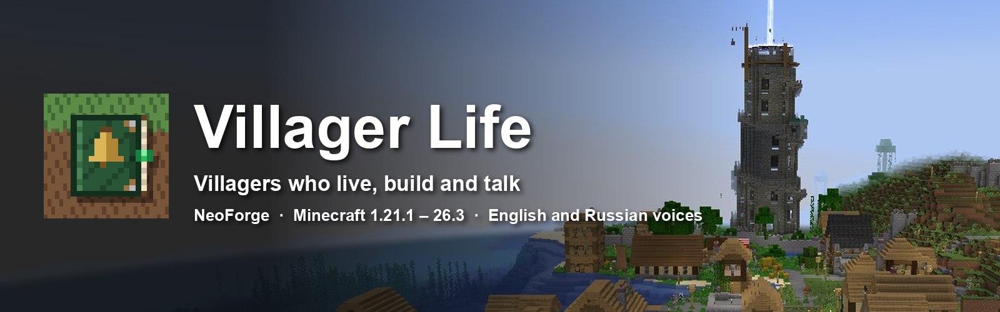
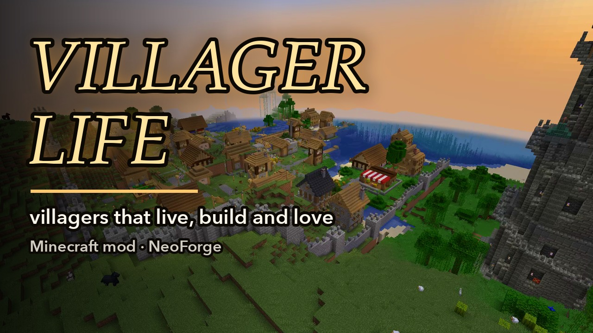
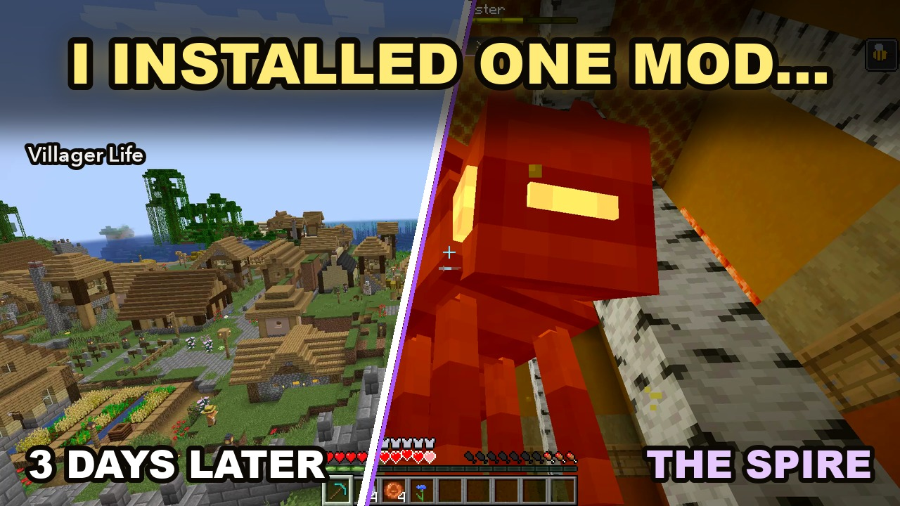
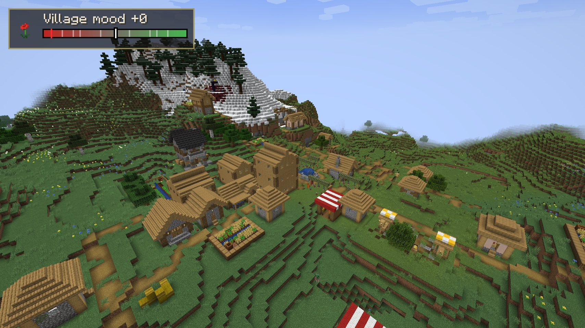
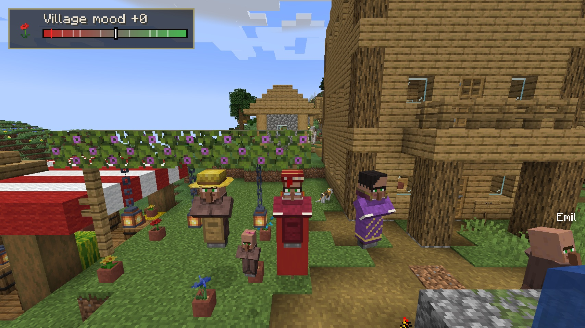
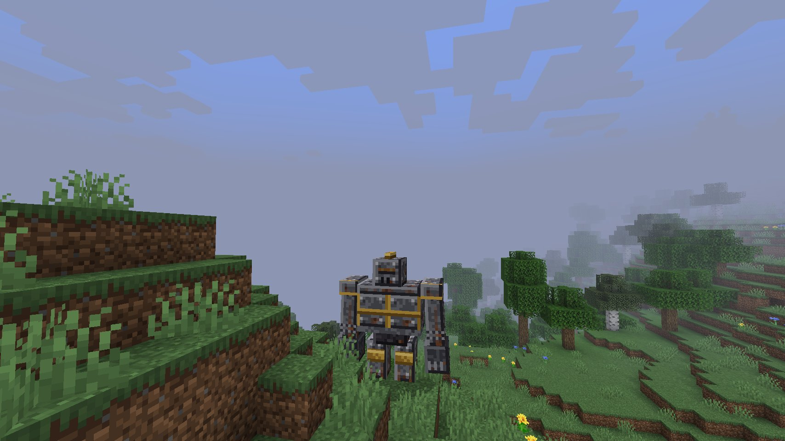
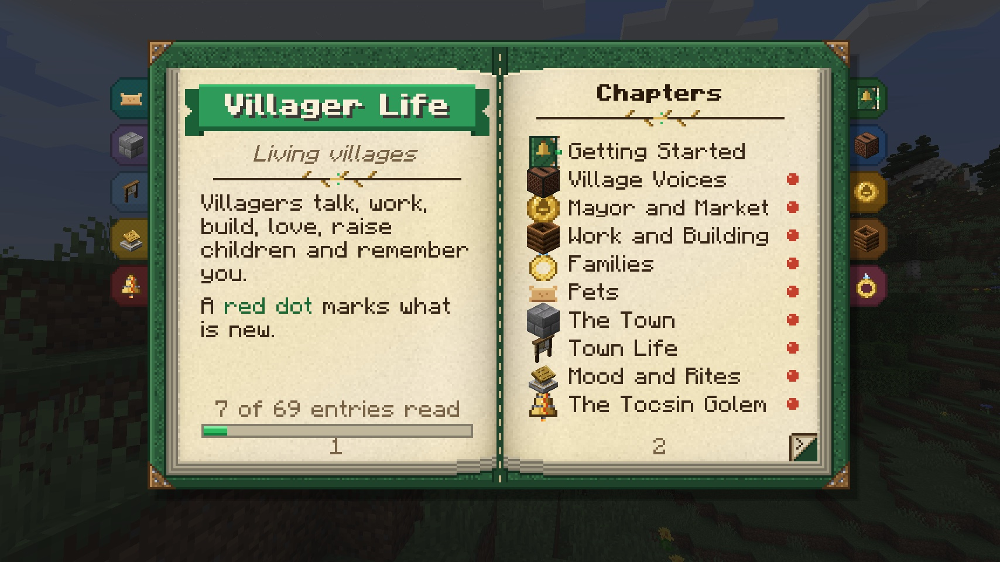

<p align="center"></p>

<p align="center">
A NeoForge mod that turns a village into a living town: villagers work, build their houses and their town by hand,
marry, raise children, grow old, trade at the village stall with real coins, and talk about all of it
in <b>English and Russian voices</b>.
</p>

<p align="center">
<a href="https://github.com/s00d/villager-life/releases"></a>
<a href="https://github.com/s00d/villager-life/actions/workflows/build.yml"></a>
<a href="LICENSE"></a>
<a href="https://modrinth.com/mod/villager-life-s00d"></a>
<a href="https://www.curseforge.com/minecraft/mc-mods/villager-life-s00d"></a>
<a href="https://discord.gg/JkNspxqWk9"></a>
· <a href="README.ru.md">Русский</a>
</p>

## Videos

<table>
<tr><td align="center"><a href="https://youtu.be/oe4SSerVNHs"></a><br><b>Overview</b> (3:13): a village grows into a town, then the Spire</td>
<td align="center"><a href="https://youtu.be/VIsO7N__Pn0"></a><br><b>Let's play</b> (3:40): one mod, and the village comes alive</td></tr>
</table>

In Russian: [overview](https://youtu.be/mHCvLn-c2_s) · [let's play](https://youtu.be/dO6bLLSdPL4).

## What the villagers do

- **Talk.** Over a thousand dialogue groups, voiced in English or Russian — one jar per voice language, whatever language the game is in: reactions to the player and the world, conversations between villagers, women's and children's voices of their own, a crying infant, a talking parrot. Up to three voices at a time in a neighbourhood, with subtitles.
- **Work.** Every profession has its workshop (three tiers, built by the worker by hand), its daily chores and twelve workstations with their own menus (smokehouse, kiln, dye vat, fish trap, reading desk…). The farmer runs a real farm and keeps bees; the butcher and the shepherd keep their pens.
- **Build by hand.** Houses go up block by block from vanilla structure files — two or three storeys, a floor or a cellar more as the family grows — with materials bought at the stall. Nothing appears from thin air.
- **Live as families.** Courtship, weddings led by the mayor, a nursery made ready before a baby, a newborn's first day in its cradle, lessons, a father's trade taken up, old age, quiet deaths, funerals and a graveyard. Pets: a dog with its kennel, a cat, a parrot that learns words.
- **Ask for help.** What a household cannot get for itself it posts as an errand on the notice board: take it, an arrow on the screen leads you to the villager, hand the thing over and get paid.
- **Plan their town.** Streets from the square and lots along them are laid out over the lie of the land; houses go up on the lots facing their street. Buy a free lot at the notice board and build what you like there — no villager touches it.
- **Run a town.** An elected mayor with a town hall, a shopkeeper with a stall, copper, silver and gold coins, wages, a treasury, a caravan every week. Roads with lamps and bridges, a paved square with a well, a **chapel with a tower clock**, a bakehouse, a tavern, and at last a **stone wall** with towers, gates with crossbows and a dry ditch. A family pays for its own house; the treasury pays for the town's.
- **Feel about you.** The village's mood is its opinion of the player: trade, gifts and help raise it; harm, theft and explosions lower it. High or low, it brings rites — festoons, festivals, vigils, a pyre — and at its darkest the **Tocsin Golem**, a bell-bodied boss.
- **Keep safe.** Doors are shut behind them, dark corners get torches, the homeless find a closed room for the night, a storm sends everyone indoors, and a town keeps iron golems and a night watch.
- **Grow and split.** A full village sends couples off to found hamlets of their own.
- **Climb the Spire.** A finished town raises the Spire of the Architects beyond its walls: a hundred floors in ten chapters, each with its guards, a keeper of its own on every tenth floor and trials in between. Villagers go up on expeditions and come back as heroes in the Spire's gear; the town gets a second age.

The **Villager Life Guide** (a book given on first join, also crafted from three paper) explains all of it in game, in both languages.

## Screenshots

<table>
<tr><td align="center"><br>A village</td><td align="center"><br>Women, men and children, each with their look</td></tr>
<tr><td align="center"><br>The Tocsin Golem</td><td align="center"><br>The Villager Life Guide</td></tr>
</table>

## Versions

One jar per Minecraft version, from the same code. All need only NeoForge; [JEI](https://modrinth.com/mod/jei) or [EMI](https://modrinth.com/mod/emi) are optional (workstation and rite recipes).

| Minecraft | NeoForge | Java | Jar |
|---|---|---|---|
| 1.21.1 | 21.1.252+ | 21 | `villager-life-1.0.0+1.21.1-en.jar`, `-ru.jar` |
| 1.21.4 | 21.4.161+ | 21 | `villager-life-1.0.0+1.21.4-en.jar`, `-ru.jar` |
| 1.21.8 | 21.8.57+ | 21 | `villager-life-1.0.0+1.21.8-en.jar`, `-ru.jar` |
| 1.21.11 | 21.11.48+ | 21 | `villager-life-1.0.0+1.21.11-en.jar`, `-ru.jar` |
| 26.1.2 | 26.1.2.122+ | 25 | `villager-life-1.0.0+26.1.2-en.jar`, `-ru.jar` |
| 26.2 | 26.2.0.93+ | 25 | `villager-life-1.0.0+26.2-en.jar`, `-ru.jar` |
| 26.3 | 26.3.0.95+ | 25 | `villager-life-1.0.0+26.3-en.jar`, `-ru.jar` |

1.21.1 is the main version: every check runs there first.

## Installation

1. Install NeoForge for your Minecraft version.
2. Download the jar for that version from [Modrinth](https://modrinth.com/mod/villager-life-s00d), [CurseForge](https://www.curseforge.com/minecraft/mc-mods/villager-life-s00d) or [Releases](https://github.com/s00d/villager-life/releases) and put it into `mods`. Take **one** voice: `-en` (English voices) or `-ru` (Russian voices); the text follows your game language either way.
3. On a server, install the mod on the server and on every client.

Settings: the guide's settings page or the config button in the NeoForge Mods list
(`config/villager-life.json`, `villager-life-client.json`, `villager-life-mood.json`).

## FAQ

**Does it work in an existing world?** Yes. Villages generated before the mod are taken over: their houses can grow, their streets become the town's roads.

**Is it heavy on a server?** A town is simulated in full only while a player is near it (its chunks are held for a few minutes after the player leaves, `townChunkLoading`); without players it sleeps like a vanilla village.

**Can I turn the voices off?** Voices play in the "Friendly Creatures" volume; `chattiness` in `villager-life.json` makes villagers talk less; subtitles are a client setting.

**Can I play with other players?** Yes, on a dedicated server or LAN. The village's mood is shared; shop limits and errands are per player.

**Other languages?** The interface and the guide are in English and Russian; voices too. Translations of strings are welcome — see [CONTRIBUTING](CONTRIBUTING.md).

**Other mod loaders?** NeoForge only.

**Questions, bugs, ideas?** Join the [Discord](https://discord.gg/JkNspxqWk9) — English channels and a Russian one.

## Building from source

```bash
./gradlew --no-configuration-cache build                                  # every version
./gradlew --no-configuration-cache :neoforge:1.21.1:build                 # one version
./gradlew --no-configuration-cache :neoforge:1.21.1:runGameTestServer     # game tests
```

Java 21 (and 25 for 26.x). Jars land in `neoforge/versions/<version>/build/libs/`. The build runs ErrorProne, NullAway and SpotBugs with `-Werror`. [`AGENTS.md`](AGENTS.md) describes the code, the tools and the rules of the project; [`CONTRIBUTING.md`](CONTRIBUTING.md) — how to help; [`DEVELOPMENT_TOOLS.md`](DEVELOPMENT_TOOLS.md) — the tools and MCP servers the mod is made with.

## Credits and licences

- **Villager Life:** s00d. All rights reserved. The source is open to read and study, not to copy, modify or redistribute — see the [Villager Life License](LICENSE). Modpacks that download the official file, videos and streams are welcome.

### Assets — all made for this mod

Every asset of Villager Life was made for it. Nothing is taken from other mods, add-ons or resource packs, and no Minecraft files are copied into the mod (some models point at vanilla textures by name, as resource packs do).

- **Made by hand or drawn by scripts** in `tools/art/`: models, block and item textures, the icon, the guide's art, the structures (built in game with structure blocks).
- **Written for the mod:** every dialogue line (English and Russian), the guide, the Spire's texts.
- **Generated with AI tools, for this mod:**
  - **Voices:** Fish Audio S2 Pro, run locally (`tools/voice/`), from the mod's own lines.
  - **Sound effects** (`sounds/sfx/`): ElevenLabs Sound Effects v2 through [fal](https://fal.ai) (`tools/art/sfx/`, prompts in `batch*.tsv`).
  - **Music** (all nine tracks): Google Lyria 3.5 through fal; the fair tune — ElevenLabs Music v2.5 (`tools/art/fal/music/fal_manifest.jsonl`).
- **Screenshots** are taken in game, unedited. **Videos:** in-game footage recorded by the mod's own dev recorder; narration (ElevenLabs) and music (Google Lyria) generated through fal for the videos (`tools/trailer/`).

### AI assistance

This mod was written with substantial help from an AI assistant (Claude, by Anthropic).
