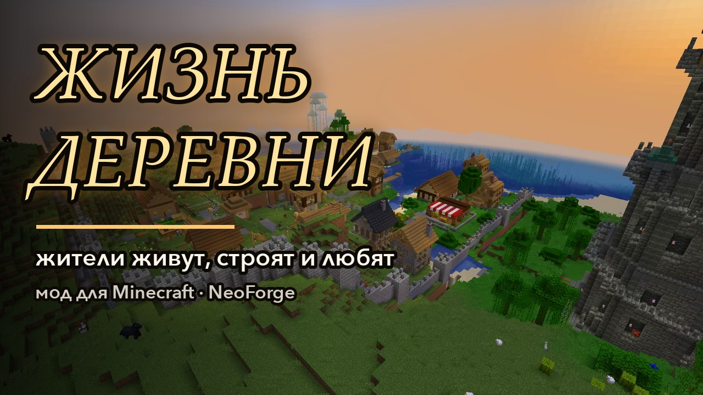
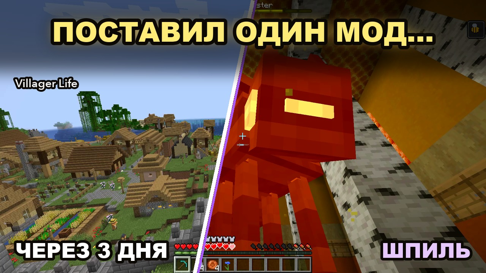

<p align="center"></p>

<p align="center">
Мод для NeoForge, который превращает деревню в живой город: жители работают, руками строят свои дома и свой город,
женятся, растят детей, стареют, торгуют в деревенской лавке настоящими монетами и говорят обо всём этом —
<b>английскими и русскими голосами</b>.
</p>

<p align="center">
<a href="https://github.com/s00d/villager-life/releases"></a>
<a href="https://github.com/s00d/villager-life/actions/workflows/build.yml"></a>
<a href="LICENSE"></a>
<a href="https://modrinth.com/mod/villager-life-s00d"></a>
<a href="https://www.curseforge.com/minecraft/mc-mods/villager-life-s00d"></a>
<a href="https://discord.gg/JkNspxqWk9"></a>
· <a href="README.md">English</a>
</p>

## Видео

<table>
<tr><td align="center"><a href="https://youtu.be/mHCvLn-c2_s"></a><br><b>Обзор</b> (3:13): деревня вырастает в город, потом Шпиль</td>
<td align="center"><a href="https://youtu.be/dO6bLLSdPL4"></a><br><b>Прохождение</b> (3:40): один мод — и деревня ожила</td></tr>
</table>

На английском: [обзор](https://youtu.be/oe4SSerVNHs) · [прохождение](https://youtu.be/VIsO7N__Pn0).

## Что делают жители

- **Говорят.** Больше тысячи групп реплик, озвученных по-английски или по-русски — свой jar на каждый язык озвучки, какой бы язык ни стоял в игре: реакции на игрока и мир, разговоры между жителями, свои голоса у женщин и детей, плач младенца, говорящий попугай. В округе — не больше трёх голосов разом, с субтитрами.
- **Работают.** У каждой профессии своя мастерская (три уровня, строит сам работник), свои дела и двенадцать станков с окнами (коптильня, печь для обжига, красильный чан, верша, письменный стол…). У фермера настоящая ферма и пасека, у мясника и пастуха — загоны.
- **Строят руками.** Дома растут блок за блоком по ванильным структурам — два-три этажа, ещё этаж или подвал, когда семья растёт, — из материалов, купленных в лавке. Ничего не берётся из воздуха.
- **Живут семьями.** Ухаживание, свадьба у мэра, детская, которую готовят заранее, первый день младенца в кроватке, уроки, ремесло отца, старость, тихий уход, похороны и кладбище. Питомцы: собака с будкой, кошка, попугай, который учит слова.
- **Просят о помощи.** Чего семья не может достать сама, она вешает заданием на доску объявлений: возьмите задание, стрелка на экране приведёт к жителю, отдайте вещь и получите плату.
- **Планируют город.** Улицы от площади и участки вдоль них размечаются по рельефу; дома встают на участки лицом к улице. Свободный участок можно купить на доске и строить там что угодно — жители его не тронут.
- **Ведут город.** Выборный мэр с ратушей, лавочник с лавкой, медные, серебряные и золотые монеты, зарплаты, казна, караван раз в неделю. Дороги с фонарями и мостами, площадь с колодцем, **часовня с башенными часами**, пекарня, таверна и, наконец, **каменная стена** с башнями, воротами с самострелами и сухим рвом. Свой дом семья оплачивает сама, городское — казна.
- **Относятся к вам.** Настроение деревни — её мнение об игроке: торговля, подарки и помощь поднимают его, вред, кражи и взрывы — опускают. На высоте и в глубине — обряды (гирлянды, праздник, бдение, костёр), а в самой тьме — **Набатный голем**, босс с колоколом в груди.
- **Берегут себя.** Закрывают за собой двери, ставят факелы в тёмных углах, бездомные ночуют в закрытой комнате, в грозу все уходят под крышу, город держит железных големов и ночную стражу.
- **Растут и расходятся.** Полная деревня отпускает пары основывать свои хутора.
- **Поднимаются на Шпиль.** У достроенного города за стеной вырастает Шпиль Зодчих: сто этажей в десяти главах, на каждом — стражи, на каждом десятом — свой хранитель, между ними — испытания. Жители уходят в походы и возвращаются героями в снаряжении Шпиля, а город начинает второй век.

**«Руководство „Жизни деревни“»** (книга при первом входе, крафт из трёх бумаг) объясняет всё это в игре на двух языках.

## Скриншоты

<table>
<tr><td align="center"><br>Деревня</td><td align="center"><br>Женщины, мужчины и дети, у каждого свой вид</td></tr>
<tr><td align="center"><br>Набатный голем</td><td align="center"><br>Руководство «Жизни деревни»</td></tr>
</table>

## Версии

По jar-у на версию Minecraft, из одного кода. Нужен только NeoForge; [JEI](https://modrinth.com/mod/jei) или [EMI](https://modrinth.com/mod/emi) — по желанию (рецепты станков и обрядов).

| Minecraft | NeoForge | Java | Jar |
|---|---|---|---|
| 1.21.1 | 21.1.252+ | 21 | `villager-life-1.0.0+1.21.1-en.jar`, `-ru.jar` |
| 1.21.4 | 21.4.161+ | 21 | `villager-life-1.0.0+1.21.4-en.jar`, `-ru.jar` |
| 1.21.8 | 21.8.57+ | 21 | `villager-life-1.0.0+1.21.8-en.jar`, `-ru.jar` |
| 1.21.11 | 21.11.48+ | 21 | `villager-life-1.0.0+1.21.11-en.jar`, `-ru.jar` |
| 26.1.2 | 26.1.2.122+ | 25 | `villager-life-1.0.0+26.1.2-en.jar`, `-ru.jar` |
| 26.2 | 26.2.0.93+ | 25 | `villager-life-1.0.0+26.2-en.jar`, `-ru.jar` |
| 26.3 | 26.3.0.95+ | 25 | `villager-life-1.0.0+26.3-en.jar`, `-ru.jar` |

Основная версия — 1.21.1: все проверки сначала идут на ней.

## Установка

1. Установите NeoForge для своей версии Minecraft.
2. Скачайте jar этой версии с [Modrinth](https://modrinth.com/mod/villager-life-s00d), [CurseForge](https://www.curseforge.com/minecraft/mc-mods/villager-life-s00d) или со страницы [Releases](https://github.com/s00d/villager-life/releases) и положите в `mods`. Берите **один** голос: `-en` (английская озвучка) или `-ru` (русская); тексты в любом случае на языке игры.
3. На сервере мод нужен и серверу, и каждому клиенту.

Настройки: страница настроек в книге или кнопка настроек в списке модов NeoForge
(`config/villager-life.json`, `villager-life-client.json`, `villager-life-mood.json`).

## Вопросы

**Работает в старом мире?** Да. Деревни, созданные до мода, подхватываются: их дома растут, их улицы становятся дорогами города.

**Не тяжело серверу?** Город считается целиком, только пока рядом игрок (его чанки держатся ещё несколько минут после ухода, `townChunkLoading`); без игроков он спит, как ванильная деревня.

**Можно потише?** Голоса идут в громкости «Дружелюбные существа»; `chattiness` в `villager-life.json` делает жителей молчаливее; субтитры — настройка клиента.

**Мультиплеер?** Да, выделенный сервер или LAN. Настроение деревни общее, лимиты лавки и задания — у каждого игрока свои.

**Другие языки?** Интерфейс, книга и голоса — английский и русский. Переводы строк приветствуются — см. [CONTRIBUTING](CONTRIBUTING.md).

**Другие загрузчики?** Только NeoForge.

**Вопросы, баги, идеи?** Заходите в [Discord](https://discord.gg/JkNspxqWk9) — там есть русский канал.

## Сборка

```bash
./gradlew --no-configuration-cache build                                  # все версии
./gradlew --no-configuration-cache :neoforge:1.21.1:build                 # одна версия
./gradlew --no-configuration-cache :neoforge:1.21.1:runGameTestServer     # игровые тесты
```

Java 21 (и 25 для 26.x). Jar-ы — в `neoforge/versions/<версия>/build/libs/`. Сборка запускает ErrorProne, NullAway и SpotBugs с `-Werror`. [`AGENTS.md`](AGENTS.md) описывает код, инструменты и правила проекта; [`CONTRIBUTING.md`](CONTRIBUTING.md) — как помочь; [`DEVELOPMENT_TOOLS.md`](DEVELOPMENT_TOOLS.md) — инструменты и MCP-серверы, которыми сделан мод (на английском).

## Авторы и лицензии

- **Villager Life:** s00d. Все права защищены. Код открыт, чтобы его читать и изучать, но копировать, изменять и распространять его нельзя — см. [лицензию Villager Life](LICENSE). Сборки, которые скачивают официальный файл, видео и стримы — пожалуйста.

### Ассеты — всё сделано для этого мода

Каждый ассет «Жизни деревни» сделан для неё. Ничего не взято из других модов, аддонов и ресурспаков, файлы Minecraft в мод не копируются (часть моделей ссылается на ванильные текстуры по имени, как ресурспаки).

- **Руками или скриптами** в `tools/art/`: модели, текстуры блоков и предметов, иконка, оформление книги, постройки (собраны в игре структурными блоками).
- **Написано для мода:** все реплики (английские и русские), книга, тексты Шпиля.
- **Сгенерировано ИИ-инструментами, для этого мода:**
  - **Голоса:** Fish Audio S2 Pro, локально (`tools/voice/`), по репликам мода.
  - **Звуки** (`sounds/sfx/`): ElevenLabs Sound Effects v2 через [fal](https://fal.ai) (`tools/art/sfx/`, промпты в `batch*.tsv`).
  - **Музыка** (все девять треков): Google Lyria 3.5 через fal; ярмарочная — ElevenLabs Music v2.5 (`tools/art/fal/music/fal_manifest.jsonl`).
- **Скриншоты** сделаны в игре, без обработки. **Видео:** игровые кадры, записанные рекордером мода; закадровый голос (ElevenLabs) и музыка (Google Lyria) для роликов сгенерированы через fal (`tools/trailer/`).

### Помощь ИИ

Мод написан при существенной помощи ИИ-ассистента (Claude, Anthropic).
