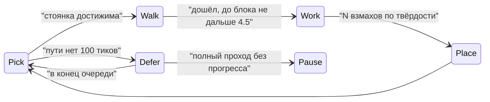

# Villager Life 1.4: стройка руками, профессии как жизнь, свои дома, полезные предметы

## Что сейчас не так (по коду)

- [`Workshops.tick`](neoforge/src/main/java/com/vnap/village/workshop/Workshops.java) зовётся из `ContextualDialogueController.processConversations` раз в 100 тиков и только рядом с игроком. Если житель не дошёл до места за `STUCK_LIMIT = 12` попыток, `job.placeNext` ставит блок издалека. Отсюда «блоки просто появляются».
- `build()` каждый раз перезаписывает `WALK_TARGET` и не учитывает активности мозга. Из-за этого паника и ночной уход домой ломаются или конфликтуют.
- Ванильный `SetWalkTargetFromBlockMemory(JOB_SITE, ..., tooFar=100, tooLong=1200)` стирает `JOB_SITE`, если житель долго был далеко. Строитель «уходит и не возвращается».
- [`BuildJob`](neoforge/src/main/java/com/vnap/village/build/BuildJob.java) ставит блоки в порядке схематики: пропы и интерьер идут до стен, крыша идёт до проёмов.
- [`ProfessionWork.produce`](neoforge/src/main/java/com/vnap/village/workshop/ProfessionWork.java) раз в день кладёт предметы в сундук и спавнит корову из воздуха. Жизни здесь нет.
- [`VillagerHome`](neoforge/src/main/java/com/vnap/dialogue/VillagerHome.java) умеет только занять готовую кровать.

## Архитектура: поведения ванильного мозга

Опора — ванильные `HarvestFarmland`, `WorkAtComposter`, `StrollToPoi`, `VillagerPanicTrigger` и пакеты из `VillagerGoalPackages`. Подключение — новый миксин `VillagerGoalPackagesMixin`, `@Inject` на `RETURN` в статические `getWorkPackage` и `getIdlePackage`. Он дописывает наши `Behavior<Villager>`. Унаследованных `@Shadow` нет.

Что это даёт без лишнего кода:
- расписание: WORK 2000–9000, ночью REST и сон в кровати;
- паника от урона и мобов (активность PANIC вытесняет WORK, `stop()` у нас освобождает цели);
- поведения тикают каждый тик для всех загруженных жителей, а не раз в 5 с рядом с игроком.

Порядок стадий стройки взят у MineColonies (CLEAR, SOLID, DECORATE). Ограничения задач по радиусу — по образцу «chores» из MCA Reborn.

## Фаза A. Строитель руками, день и ночь, паника, стены первыми

- Новый пакет `com.vnap.village.life`, в нём `BuildBehavior` (состояния на диаграмме выше).
  - Стоянки — ходибельные клетки (твёрдый пол и две клетки воздуха) вокруг и внутри уже построенного; путь проверяется через `navigation.createPath`.
  - Работа: блок в руке, `swing` каждые 6–8 тиков, звук удара и частицы блока, 20–40 тиков по твёрдости, затем установка.
  - Удалённой установки больше нет.
- `BuildJob`: порядок по стадиям, внутри стадии снизу вверх.
  1. Грунт и фундамент.
  2. Несущие полные блоки стен и столбов.
  3. Перекрытия и лестницы на следующий этаж.
  4. Крыша.
  5. Проёмы: двери, стёкла, люки.
  6. Интерьер и декор, кровать последней.
  
  Классификация — по форме, высоте и тегам блока, без ручной разметки.
- Привязка к месту:
  - `WorkshopState` хранит якорь даже при потере `JOB_SITE`;
  - в рабочее время дальний житель (дальше 9, но не дальше 64) идёт обратно сам;
  - если POI свободен, `JOB_SITE` занимается заново через `PoiManager.take`.
- Ночь — ванильный REST; поведение работает только в активности WORK. Убрать вызовы `Workshops.tick` из `processConversations` (решения, `standSpot`, `walkTo`, `STUCK_LIMIT`). Планирование `plan` и `fits` не меняется.
- Тайминги — в `MoodConfig`, чтобы в gametests их можно было ускорить.
- Gametests (`WorkshopGameTests`):
  - нет установки без взмахов рядом;
  - в t3 все стены раньше крыши, дверь после стен;
  - зомби рядом включает PANIC, курсор не растёт; после ухода зомби житель возвращается к месту;
  - телепорт на 40 блоков в рабочее время: житель приходит обратно, `JOB_SITE` восстановлен;
  - в 12500 стройка стоит, житель идёт к кровати.
- Клиент: скриншоты стройки с машущим жителем.

## Фаза B. Профессии как жизнь с лимитами

- Рамки для всех профессий:
  - радиус 12 от якоря мастерской и не дальше 48 от колокола;
  - только загруженные чанки;
  - дневные квоты и предел заполнения сундука, при полном сундуке работа стоит.
- Животные принадлежат мастерской через тег `vnap_herd`. Забивать можно только свои взрослые; именованные, на поводке и детёнышей — никогда.
- Каждая профессия — отдельный `Behavior` в WORK-пакете вместо `ProfessionWork.produce`:
  - **фермер:** заводит грядку 5×5 у мастерской (вспашка, посадка из сундука), собирает спелое, излишек пшеницы относит в сундуки мясника и пастуха;
  - **мясник:** строит загон из забора с калиткой по мини-схематике; стадо 2–6 коров или свиней, кормит до сердечек (`setInLove`), лишнее взрослое забивает раз в день, мясо в сундук, при наличии коптильни коптит;
  - **пастух:** такой же загон с овцами, стрижёт, иногда красит, шерсть в сундук;
  - **рыбак:** ищет воду не меньше 3×3 в радиусе, подходит к краю, забрасывает (удочка, поплавок частицами), улов из ванильной таблицы `gameplay/fishing`, до 6 в день;
  - **лучник (fletcher):** «роща» у мастерской на 4 точки; сажает саженцы, валит только выросшие из своих точек деревья снизу вверх с топором, пересаживает; собирает перья у кур рядом;
  - **кожевник:** берёт гнилую плоть и шкуры у мясника, дубит на раме;
  - **библиотекарь:** читает у кафедры, переписывает книги из бумаги и кожи в шкаф;
  - **картограф:** обходит точки по периметру деревни, раз в день кладёт карту деревни;
  - **жрец:** зажигает свечи, лечит раненых жителей и големов (подходит, регенерация, кулдаун);
  - **каменщик:** режет камень, меняет треснувшие блоки своей мастерской;
  - **бронник:** чинит железных големов слитком из сундука;
  - **инструментальщик:** точит инструменты на точиле и выдаёт фермеру мотыгу;
  - **оружейник:** закаляет у котла с шипением, вывешивает оружие на стойку.
- Безработные и нитвиты собирают цветы и разносят излишки (idle-пакет).
- Gametests:
  - на каждую профессию — след работы в мире и в сундуке;
  - лимиты: стадо не больше 6, сундук не больше предела;
  - радиус: никаких действий за 12 и в незагруженных чанках;
  - чужие и именованные животные не трогаются.

## Фаза C. Свои дома у бездомных

- `HomeProject`:
  - условия: у жителя нет кровати после N дней, в радиусе 48 от колокола нет свободной;
  - шанс 10% в день; не больше одного проекта на деревню;
  - площадка в 12–40 от колокола, перепад не больше 1, проверка через `Workshops.fits` с учётом мастерских;
  - проект сохраняется в `VillageMoodSavedData`.
- Генератор `tools/build/gen_houses.py` по образцу `gen_workshops.py`:
  - 6–8 планов на 2–3 этажа (лестница или стремянка внутри, балкон, эркер, мансарда);
  - палитры по биому: равнины, тайга, пустыня, саванна, снег.
  - Подмена палитры при загрузке `SchematicSpec`, без копий файлов.
- Строит хозяин тем же `BuildBehavior`, безработные помогают. Этажи по стадиям, так что стоянки есть на уже построенном полу. Последними ставятся кровать и дверь, дальше существующий `VillagerHome.tryClaim` вешает табличку с именем.
- Gametests:
  - каждый план собирается целиком;
  - разные биомы дают разные палитры;
  - дом не пересекает мастерские;
  - проект не стартует при свободной кровати;
  - после постройки у жителя `HOME` на новую кровать.

## Фаза D. Полезные предметы (медленно, без поломки баланса)

Ориентиры: Farmer's Delight (доска, котёл), Supplementaries, сушилки из Hearth and Home. Только `BlockEntity` с медленным прогрессом, всё через ванильный API (`getEnchantPowerBonus`, `ItemFishedEvent`, `MenuType`).

**26 декор-блоков:**
- **фермер:** `seed_sacks` — склад семян, раз в утро сажает на пустую пашню рядом; `harvest_basket` — собирает выпавший урожай в радиусе 4;
- **мясник:** `chopping_block` — бревно и топор, 3 удара дают 6 досок; `meat_rack` — вялит сырое мясо в готовое за четверть дня;
- **пастух:** `wool_bales` — склад шерсти, овцы рядом обрастают быстрее; `spinning_wheel` — GUI, шерсть в 3 нити за 10 с;
- **рыбак:** `fish_rack` — сушка рыбы; `tackle_crate` — склад и +10% к шансу дополнительного улова рядом;
- **лучник (fletcher):** `arrow_bundle` — колчан на 64 стрелы на стене; `feather_basket` — куры рядом изредка роняют перья в корзину, лимит 16;
- **библиотекарь:** `book_stack` — 1–4 книги, +1 силы чар; `ink_and_quill` — GUI, медленное копирование подписанных книг;
- **картограф:** `globe` — вращение, направление к своей деревне; `map_rolls` — склад карт, выдаёт карту деревни;
- **жрец:** `incense_burner` — топливо (огненный порошок), регенерация I импульсами в радиусе 6; `potion_shelf` — витрина зелий с компаратором;
- **кожевник:** `hide_rack` — гнилая плоть в кожу за день; `leather_rolls` — медленно чинит кожаную броню кожей;
- **каменщик:** `chisel_bench` — GUI, кирпич в треснутый, резной или мшистый; `brick_pallet` — склад кирпича с видимыми слоями;
- **бронник:** `armor_dummy` — манекен с бронёй; `chainmail_rack` — GUI, цепи в кольчугу;
- **инструментальщик:** `tool_rack` — 4 инструмента, медленная починка самородками из `nail_keg`;
- **оружейник:** `weapon_rack` — витрина; `sword_barrel` — точило, временная заточка +1 урона на N ударов.

**13 новых функциональных блоков с GUI, по одному на профессию:**
- теплица-ящик;
- коптильня;
- красильный чан;
- верша;
- оперительный станок (GUI на ванильный fletching table через событие);
- читальный стол;
- межевой стол;
- купель;
- дубильный чан;
- обжиговая печь;
- бронный верстак;
- точильный круг;
- оружейный горн.

Каждый новый блок попадает в мастерскую t3 вместо одного пропа.

**Существующие предметы:**
- шляпа мэра: небольшая прибавка к standing рядом;
- микрофон: созывает жителей к колоколу, кулдаун 5 мин;
- усы: свои реплики приветствия.

**Сопровождение и проверки:**
- арт: генераторы `gen_decor.py` и новый `gen_machines.py`; локализация ru/en, справочник, JEI/EMI;
- gametests: прогресс идёт только со временем; лимиты; GUI-меню открывается и сохраняет предметы; полнота модели, текстуры и имени (существующий `everyItemHasModelTextureAndName`).

## Общие правила

- После каждой фазы:
  - `runGameTestServer` и `build`;
  - `runClient` со скриншотами;
  - jar в профиль «my».
- Остаются в силе:
  - `-Werror`, NullAway, ErrorProne;
  - без коммитов и без `--amend`;
  - полные логи в `/tmp/vl14-*.log`.
- Удаляется устаревшее: `ProfessionWork.produce` и спавн из воздуха, внешний тик стройки, `STUCK_LIMIT`.