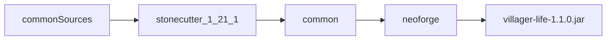

# Структура и проверки Villager Life

Сейчас всё лежит в одном модуле: [build.gradle](/Users/s00d/Downloads/FireShot/villager-news-ru-port/build.gradle) с ModDevGradle, 86 Java-файлов в `src/main/java`, GameTests нет. Репозиторий не переименовываем. Идентификаторы предметов `villager-news-addon-port` не трогаем.

Один JAR на Forge, NeoForge, Fabric и Quilt не делаем: такого загрузчика нет. Architectury как обязательную библиотеку не тащим: она заставила бы переписать регистрацию, сеть и события, а второй загрузчик всё равно не выпускается. Раскладка как у [MultiLoader-Template](https://github.com/jaredlll08/MultiLoader-Template): общая логика отдельно, загрузчик отдельно.

[Stonecutter](https://github.com/StonecutterMC/stonecutter) подключаем сразу, но активная версия одна: Minecraft 1.21.1 / NeoForge 21.1.252. Вторая ветка версии появится только когда появится вторая цель. Пока компиляция и GameTests зелёные на одной версии, группировать патч-релизы в один JAR рано: успешная сборка не доказывает бинарную совместимость. Alternative Realities так и делает: один файл только на проверенную группу, отдельный файл на несовместимое поколение.

## Структура

- В [settings.gradle](/Users/s00d/Downloads/FireShot/villager-news-ru-port/settings.gradle) подключить `common` и `neoforge`.
- Текущие исходники, ресурсы, миксины и `neoforge.mods.toml` переехать в `neoforge/`. Это единственный модуль, которому разрешены `net.neoforged` и клиентский код.
- `common` — обычная Java-библиотека на том же classpath Minecraft (Mojmap), без NeoForge API. Туда сразу переносятся только классы без импортов загрузчика: флаги и пороги настроения, очередь обрядов, разбор схем. Регистрация блоков, пакеты, миксины и клиент остаются в `neoforge`.
- `neoforge` зависит от `common` и по-прежнему собирает `villager-life-1.1.0.jar`. Имя мода `villager_life` не меняется.
- Пустой модуль Fabric не создаём, чтобы не поддерживать мёртвую сборку.
- Stonecutter держит одну активную версию `1.21.1`. Условные фрагменты под другие версии не пишем, пока их не с чем сверять.

## Проверки

Компилятор уже ловит чужие сигнатуры. Поверх него, на оба модуля:

- `javac -Xlint:all` и `-Werror` только для новых предупреждений, которые не завалят сборку сотней старых. Существующий шум фиксируем списком, а не выключаем проверку целиком.
- Error Prone в `compileJava`: ошибки уровня ERROR валят сборку. Включаем проверки на мёртвый код, неправильные сравнения, утечки ресурсов и подозрительные switch. Не включаем весь каталог «в ошибку» с первого дня.
- NullAway поверх Error Prone, сначала только пакеты `com.vnap.mood` и `com.vnap.village`. На остальной код и на классы Minecraft он даст лавину ложных `null`, поэтому не делаем его ошибкой для всего дерева.
- SpotBugs отдельной задачей `spotbugsMain`, отчёт в `build/reports`. В CI задача обязательна; падение сборки только по High.
- Checker Framework не подключаем: на мод с вызовами Minecraft он почти ничего не добавляет сверх NullAway, а аннотации придётся раскидать по всем 86 файлам.
## GameTests

Статический анализ не видит регистрацию, миксины и то, что блок в схеме не ставится. Это закрывает `gameTestServer`, который уже описан в ModDevGradle. Тесты живут в `neoforge` и крутят серверную логику в [VillageMoodApi](/Users/s00d/Downloads/FireShot/villager-news-ru-port/src/main/java/com/vnap/mood/VillageMoodApi.java), [VillageRites](/Users/s00d/Downloads/FireShot/villager-news-ru-port/src/main/java/com/vnap/mood/VillageRites.java) и [VillageScriptDirector](/Users/s00d/Downloads/FireShot/villager-news-ru-port/src/main/java/com/vnap/village/script/VillageScriptDirector.java). Клиентский пропуск отсутствующего ogg GameTest не покрывает: на сервере нет звукового движка.

Набор, каждый отдельным тестом:

- Прыжок 0 в 100 ставит в очередь только первый недостающий обряд, второй не стартует, пока слот занят.
- После завершения первого следующий порог берётся сам, без повторного прыжка.
- Повторный порог −60 не ставит второй алтарь, если флаг или ядро уже есть.
- Смерть босса ставит настроение ровно в 0 и не запускает стройку. Шрам и кулдаун призыва остаются.
- Слом ядра при настроении от 90 ставит −100 один раз и снимает флаг алтаря. Слом основания или колонны этого не делает.
- Флаги ±20 снимаются в полосе −10…+10. Тотем, памятник и алтарь остаются.
- Посох сдвигает настроение на 10 и останавливается на краю ±100.
- Динамо за минуту тянет настроение на 1 к нулю. Конденсатор на 10 минут останавливает спад.
- Сохранение и загрузка `MoodState` не теряет флаги, паузу спада и позиции алтаря и памятника.
- Неизвестный id скрипта из старого сохранения читается как `NONE`.
- Схемы `festoon_v1`, `vigil_v1`, `festival_v1`, `mourning_v1`, `pavilion_v1`, `pyre_v1`, `altar_v1`, `monument_v1` загружаются, и каждый id блока существует в реестре.

Сборка и анализаторы идут на Java 21, как в `java.toolchain` этого проекта. Игру по-прежнему не публикуем и второй загрузчик не плодим.
